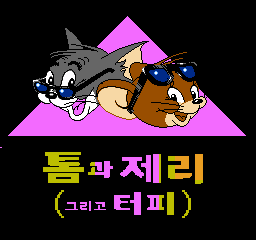

# 톰과 제리 NES 한글 패치 v1.0

일본판 **Tom & Jerry (Japan)**용 정식 한글 패치 1.0입니다. 상단 `톰과 제리`, 하단 `그리고 터피` 타이틀과 도입부·엔딩의 일본어 18행을 한국어로 바꿉니다. 터피는 이 게임의 원문에 맞춰 제리의 조카로 번역했습니다.



## 받기와 적용

1. [v1.0 릴리즈](https://github.com/akuma815/nes-tom-and-jerry-kr-patch/releases/tag/v1.0)에서 `Tom_Jerry_KR_v1.0_20261016.zip`을 받아 **압축을 모두 풉니다**.
2. 아래 SHA-256과 일치하는 원본 일본판 ROM을 따로 준비합니다. 원본이나 패치 완료 ROM은 제공하지 않습니다.
3. Windows에서는 원본 ROM을 `apply.cmd`에 끌어다 놓거나, `apply.cmd`를 열어 원본 경로를 입력합니다. 별도 패치 프로그램이나 Python 설치가 필요 없습니다.
4. 원본 옆에 생성된 `원본이름_KR_v1.0.nes`를 에뮬레이터에서 새로 열어 실행합니다. 원본은 보존됩니다.

Python 3을 사용하는 환경에서는 다음과 같이 적용할 수도 있습니다. 추가 라이브러리는 필요 없습니다.

```text
python apply.py "Tom & Jerry (Japan).nes" "Tom_Jerry_KR_v1.0.nes"
```

다른 IPS 도구로 적용할 때도 원본 해시를 먼저 확인하세요. 미국판·유럽판·헤더 없는 파일·기존 한글 패치본에 겹쳐 적용하면 안 됩니다. 이전 후보를 적용했다면 원본에서 다시 시작하세요. 포함된 적용 도구는 원본·패치·결과 해시를 검사하고 다른 내용의 기존 파일을 덮어쓰지 않습니다.

## 지원 원본과 결과

| 항목 | 값 |
| --- | --- |
| 지원 원본 | `Tom & Jerry (Japan).nes`, iNES 헤더 포함 |
| 크기 | 262,160바이트 |
| 원본 SHA-256 | `aaeceb811865b9f4736670b55cbfd4a3deae5d26374e9d10d744fc44055b524f` |
| 패치 SHA-256 | `70a12bf0a48367ee1922693cfe94ce0b185c1b49d61416e3200aa8bc64e6e0d9` |
| 적용 결과 SHA-256 | `304b67fb63ad9145fb4cb61335cfdcc46c656a7b63d106be0a45db5258a9f004` |

배포용 패치 이름은 `patches/Tom_Jerry_KR_v1.0.ips`입니다. 작업 후보 `text_kr_008`과 바이트 단위로 같은 결과를 만드는 정식 1.0 패키지입니다.

## 번역 범위와 확인한 내용

- 한글화: 타이틀 두 부분, 도입부 3페이지 12행, 엔딩 1페이지 6행. 첫 도입 페이지에서 한 문장을 두 줄로 나눴습니다.
- 그대로인 부분: `PUSH START BUTTON`, 영문 저작권·스테이지 안내·점수 등 이번 일본어 문장/타이틀 작업에 포함하지 않은 영어 표기.
- 확인: 원본 식별·빌드·패치 적용 동일성, Mesen 2.2.1 정상 부팅에서 도입 3페이지, START 후 첫 스테이지 진입, 기존 타이틀/그림 보존.
- 엔딩 6행은 원래 게임의 엔딩 루틴으로 진입시킨 **진단 실행**에서 글자와 화면을 확인했습니다. 정상 플레이로 엔딩에 도달한 검증은 아직 하지 않았습니다.
- 글자 수 변화로 도입의 글자 출력·페이지 전환 시점 일부가 달라집니다. 전체 플레이·실기·다른 에뮬레이터·오디오 검증은 미실시입니다.

기존 세이브스테이트의 호환성은 검증하지 않았습니다. 새 ROM을 콜드 부팅해 시작하세요. 저장 데이터나 상태 파일을 변환하는 기능은 없습니다.

## 화면

`screenshots/intro_1.png`~`intro_3.png`는 정상 부팅 캡처입니다. `screenshots/ending_diagnostic.png`는 엔딩 루틴 진입 진단 캡처입니다. 모든 PNG는 배포 결과와 같은 SHA-256의 ROM에서 얻은 전체 화면을 그대로 사용했습니다. `qa/runtime_verification.json`과 `qa/release_audit.json`에서 실행 증거와 배포 패키지 검사를 구분해 확인할 수 있습니다.

## 크레딧과 문의

- 한글 패치: AKUMA815.
- 한글 글꼴: quiple의 Galmuri7 2.40.3. 라이선스와 출처는 `LICENSES/OFL.txt`, `LICENSES/NOTICE.txt`를 확인하세요.
- 원작 게임·캐릭터·그림의 권리는 원 권리자에게 있습니다. 이 패치는 비공식 팬 번역입니다. 패치 프로그램과 변환 데이터, 안내 문서만 배포합니다.
- [버그 신고](https://github.com/akuma815/nes-tom-and-jerry-kr-patch/issues/new?template=site-bug-report.md): 사용한 패치 버전, 원본 해시, 에뮬레이터 버전과 재현 장면을 알려 주세요. 원본 ROM은 첨부하지 마세요.
- [한글 패치 아카이브](https://akuma815.github.io/).
